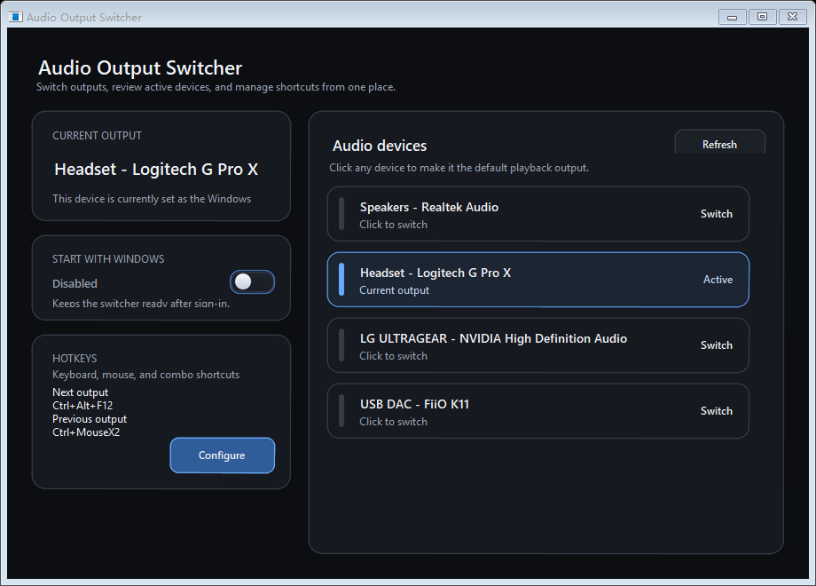
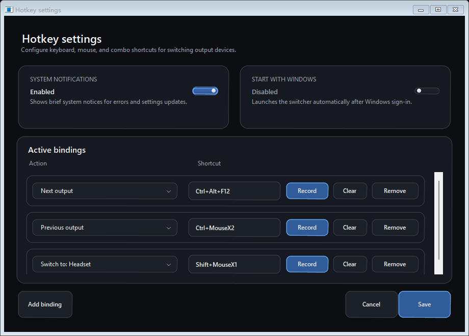

# Audio Output Switcher

一个面向 Windows 桌面的轻量级音频输出切换工具。它常驻系统托盘，支持一键切换默认播放设备、全局键盘/鼠标热键、图形化设置、自启动和弱提示通知，适合在耳机、音箱、显示器音频等输出之间频繁切换的场景。



## 项目目标

Windows 原生切换音频输出的路径比较长，通常需要：

1. 点击任务栏音量图标
2. 打开输出设备列表
3. 再手动选中目标设备

这个项目的目标就是把这件事压缩成更直接的操作：

- 托盘左键打开主页面
- 托盘右键直接切换设备
- 全局热键切换上一个或下一个设备
- 切换完成后在右下角显示简洁、点击穿透的弱提示

## 当前功能

- 托盘常驻，支持左键打开主页面、右键打开设备/功能菜单
- 主页面显示：
  - 当前默认输出设备
  - 音频设备列表
  - 开机自启动状态
  - 当前热键摘要
- 热键设置页面支持：
  - 键盘按键
  - 鼠标左/右/中键
  - 鼠标侧键 `MouseX1` / `MouseX2`
  - 键盘 + 鼠标组合键
- 支持按顺序切换设备，也支持按设备序号或名称片段直达
- 支持图形化热键录制、保存、清除、删除
- 支持切换成功/失败、设置保存、重载配置等系统提示
- 支持标准自启动和最高权限自启动两种模式
- 单实例运行：重复启动不会打开多个常驻进程，而是激活现有主窗口
- 支持命令行调用，便于接入鼠标驱动、宏工具、Stream Deck 或其他自动化流程



## 运行方式

### 托盘模式

直接双击 `AudioOutputSwitcher.exe`：

- 程序进入托盘常驻
- 左键托盘图标：打开主页面
- 右键托盘图标：打开快捷菜单

右键菜单通常包含：

- 输出设备列表
- `Next output`
- `Previous output`
- `Hotkey settings...`
- `Open config`
- `Reload config`
- `Exit`

### 命令行模式

程序也支持直接带参数执行：

```powershell
.\AudioOutputSwitcher.exe --list
.\AudioOutputSwitcher.exe --next
.\AudioOutputSwitcher.exe --previous
.\AudioOutputSwitcher.exe --device 1
.\AudioOutputSwitcher.exe --name Headphones
```

说明：

- `--list`：列出当前可用输出设备，默认设备前会带 `*`
- `--next`：切换到下一个输出设备
- `--previous`：切换到上一个输出设备
- `--device 1`：按托盘菜单中的顺序切换到第 1 个设备
- `--name Headphones`：按名称片段匹配设备并切换

这部分很适合接到：

- 鼠标驱动宏
- 键盘宏
- Stream Deck
- AutoHotkey
- 其他自动化启动器

## 热键设置

在托盘右键菜单中点击 `Hotkey settings...` 打开热键页面。

支持的输入形式包括：

```text
Ctrl+Alt+F12
Win+Alt+S
MouseX1
MouseX2
MouseMiddle
Ctrl+MouseX1
Shift+MouseRight
```

可配置的动作包括：

- `Next output`
- `Previous output`
- `Device1` / `Device2` / `Device3` ...
- `Name:设备名称片段`

你可以在界面中完成以下操作：

- 新增绑定
- 录制快捷键
- 清除单项绑定
- 删除整条绑定
- 保存后立即生效

## 配置文件

程序首次运行时，会在当前用户目录自动生成配置：

`%LOCALAPPDATA%\AudioOutputSwitcher\AudioOutputSwitcher.ini`

如果旧版本的 `exe` 同目录已有 `AudioOutputSwitcher.ini`，程序会在新位置尚无配置时复制一次；旧文件会保留，不会被自动删除。配置保存采用同目录临时文件替换，并保留上一份 `AudioOutputSwitcher.ini.bak`。无法读取主配置时，程序会尝试读取该备份；无法识别的扩展配置项在界面保存后也会继续保留。

需要真正的便携模式时，在 `exe` 同目录创建空文件 `AudioOutputSwitcher.portable`，程序才会继续使用同目录的 `AudioOutputSwitcher.ini`。

你可以手动编辑当前生效的配置文件，然后在托盘菜单中点击 `Reload config` 立即重载。

### 示例

```ini
ShowBalloon=true
RunAsAdministrator=false
Next=Ctrl+Alt+F12
Previous=Ctrl+Alt+F11
Device1=Ctrl+Alt+1
Device2=Ctrl+Alt+2
Name:Headphones=Ctrl+Alt+H
Next=MouseX1
Previous=Ctrl+MouseX2
```

### 配置项说明

- `ShowBalloon`
  - 是否显示常规系统提示与切换弱提示
  - 关闭后错误和重要警告仍会显示，并写入诊断日志
  - `true` / `false`
- `RunAsAdministrator`
  - 是否优先以管理员方式运行
  - `true` / `false`
- `Next`
  - 切换到下一个输出设备
- `Previous`
  - 切换到上一个输出设备
- `Device1`
  - 切换到第 1 个设备
- `Name:Headphones`
  - 切换到名称中包含 `Headphones` 的设备

规则说明：

- `DeviceN` 对应的是当前设备列表顺序
- `Name:xxx` 使用名称片段匹配，适合设备名称比较稳定的场景
- 同一个动作可以绑定多个输入

## 自启动与权限模式

### Start with Windows

项目支持两种开机启动方式：

1. 标准模式
   - 写入当前用户的 `HKCU\Software\Microsoft\Windows\CurrentVersion\Run`
   - 不需要管理员权限
2. 最高权限模式
   - 创建名为 `AudioOutputSwitcher` 的计划任务
   - 用于登录后以最高权限自动启动

### Run as administrator

启用该选项后：

- 手动双击启动时，程序会尝试以管理员方式重新拉起
- 如果同时开启 `Start with Windows`，启动项会自动切换为最高权限计划任务模式

适用场景：

- 前台程序本身以管理员权限运行
- 某些设备切换或热键监听需要与高完整性进程处于同一权限级别

## 提示与交互细节

- 切换成功后，右下角最小化区域附近会显示弱提示
- 提示窗口为点击穿透，不拦截鼠标操作
- 程序采用单实例设计，重复双击 `exe` 时只会激活现有实例
- 主页面和热键页面都采用桌面应用样式的暗色 UI

## 诊断日志

程序会把未处理异常、Hook/单实例通信故障和启动失败写入：

`%LOCALAPPDATA%\AudioOutputSwitcher\Logs\AudioOutputSwitcher.log`

- 单个日志文件最多约 2 MB，轮转时保留一份 `AudioOutputSwitcher.previous.log`
- 日志包含时间、程序版本、进程、线程、Windows 版本和异常堆栈
- 日志不记录用户按下的具体键位、鼠标按键或热键内容
- 程序异常退出时，优先检查该目录中的最新日志

## 构建方式

项目提供 `AudioOutputSwitcher.sln` 和 `AudioOutputSwitcher.csproj`，同时保留无需额外 SDK 的 `build.ps1`。版本号只从根目录 `VERSION` 读取；构建时会把 Git 提交号和脏工作区状态写入程序集信息，并为 EXE 生成 SHA-256 与构建身份文件。

### 环境要求

- Windows
- .NET Framework 4.8
- .NET Framework C# 编译器：
  - `C:\Windows\Microsoft.NET\Framework64\v4.0.30319\csc.exe`
  - 或 `C:\Windows\Microsoft.NET\Framework\v4.0.30319\csc.exe`

### 本地构建

在项目目录执行：

```powershell
.\build.ps1
```

默认会生成：

`AudioOutputSwitcher.exe`

同时生成：

- `AudioOutputSwitcher.exe.sha256`
- `AudioOutputSwitcher.exe.build.json`

如果缺少图标文件，构建脚本会先编译图标生成工具并补齐 `assets\speaker.ico`。`app.manifest` 明确使用 `asInvoker`；需要管理员模式时由程序进行可见的 UAC 提升，不在 EXE manifest 中强制提权。

### 发布前验证

```powershell
.\verify.ps1
```

验证脚本只在 `artifacts\verification` 生成检查产物，不覆盖正式启动器。它会检查 Release 构建、版本和提交身份、SHA-256、中性发布配置、manifest、产品消息循环以及配置原子保存与备份恢复。

## 打包发布

执行：

```powershell
powershell -ExecutionPolicy Bypass -File .\package.ps1
```

会生成：

- `package-YYYYMMDD-latest\AudioOutputSwitcher-stage-YYYYMMDD-HHmm\`
- `package-YYYYMMDD-latest\AudioOutputSwitcher-package.zip`

发布包使用 `packaging\AudioOutputSwitcher.default.ini` 中的中性配置，不复制开发机器正在使用的根目录 INI。中性配置默认关闭管理员模式且不预设活动热键；打包脚本会拒绝不符合这两项约束的模板。

仓库中的 `PACKAGING.md` 约定将打包产物维护在 `codex/package` 分支。

## 项目结构

```text
AudioOutputSwitcher/
├─ src/
│  └─ Program.cs                  # 主程序，包含托盘、主页面、热键页面、配置、启动项、Toast 等逻辑
├─ assets/                        # 程序图标与预览素材
├─ packaging/
│  └─ AudioOutputSwitcher.default.ini  # 不含个人偏好的发布默认配置
├─ previews/                      # README 预览图
├─ tools/
│  ├─ GenerateSpeakerIcon.cs      # 图标生成工具
│  ├─ GenerateAssemblyInfo.ps1    # 从 VERSION 和 Git 状态生成程序集身份
│  └─ RenderUiPreview.cs          # UI 预览相关工具
├─ AudioOutputSwitcher.sln        # Visual Studio 解决方案
├─ AudioOutputSwitcher.csproj     # .NET Framework 4.8 工程
├─ VERSION                        # 唯一产品版本源
├─ app.manifest                   # Windows 权限、DPI 与兼容性声明
├─ build.ps1                      # 本地编译脚本
├─ verify.ps1                     # 发布前自动验证
├─ package.ps1                    # 打包脚本
├─ PACKAGING.md                   # 打包分支约定
└─ README.md
```

## 技术实现概览

项目核心实现基于：

- WinForms
- Windows Core Audio 设备枚举接口
- Windows 音频策略接口，用于切换默认输出设备
- 全局低级键盘/鼠标 hook，用于监听热键
- 托盘 `NotifyIcon`
- 注册表启动项与计划任务，用于自启动

目前主要代码集中在 [src/Program.cs](src/Program.cs)。

## 兼容性与注意事项

- 这是一个 Windows 专用项目
- 全局热键监听不会拦截原始输入行为，原本的按键/鼠标动作仍然会发生
- 如果前台程序是管理员权限，而本程序不是，热键体验可能受 Windows 权限模型影响；这时建议启用 `Run as administrator`
- 某些独占全屏程序、UAC 安全桌面或受保护界面下，弱提示显示可能受系统窗口层级限制

上面最后两条是基于 Windows 桌面权限与窗口层级行为的工程判断，用来帮助排查实际使用中的边界情况。

## 适合继续扩展的方向

- 为每个设备设置独立图标或标签
- 增加音频输入设备切换
- 增加设备分组 / 收藏
- 增加多显示器定位策略
- 提供更完整的发布版本号和更新日志

---

如果你只是想直接使用：

1. 双击 `AudioOutputSwitcher.exe`
2. 在托盘里确认程序已启动
3. 左键看状态，右键切设备
4. 打开 `Hotkey settings...` 录好你自己的热键

基本就可以把系统原生那套繁琐切换流程丢掉了。
